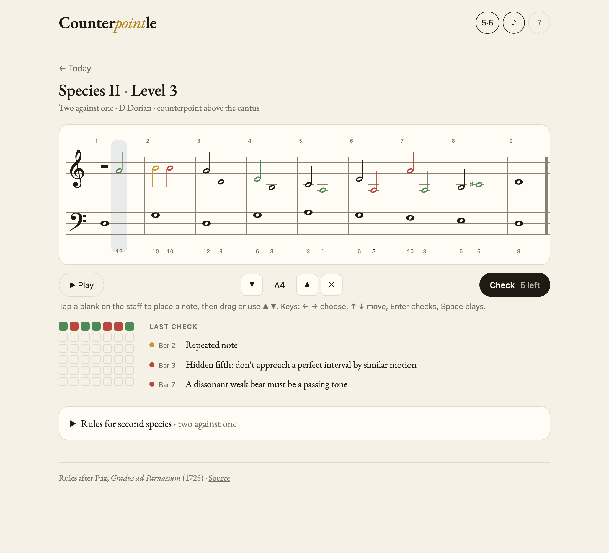
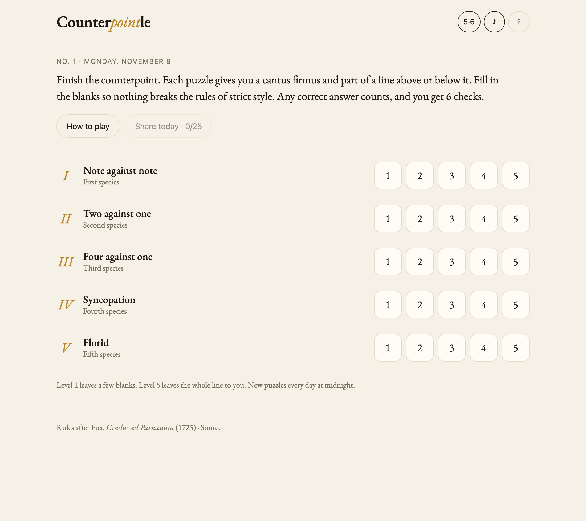
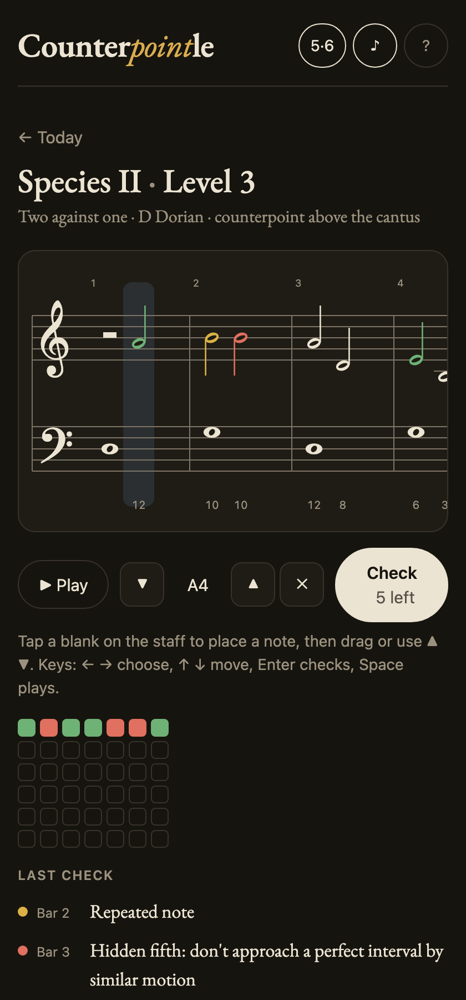

<div align="center">

# Counter*point*le

**A daily counterpoint puzzle.** Finish the line against a cantus firmus without breaking the rules.<br>
Five species, five levels each, and any correct answer counts.

**[▶ Play today's puzzles](https://counterpointle.vercel.app)**



</div>

---

Strict counterpoint works a lot like sudoku. There's a short rulebook, every note constrains its neighbors, and the fun is in finding a way through. The difference is that sudoku has one solution and counterpoint usually has dozens. Counterpointle doesn't compare your answer to a key. It checks it against the rules, the way a counterpoint teacher would.

## How it plays

Each day brings **25 puzzles**: five levels for each of Fux's five species. Every puzzle gives you a cantus firmus (the whole notes) and a counterpoint line with some notes missing. Level 1 leaves a few blanks. Level 5 leaves the whole line to you.

Tap a blank to drop a note, drag to adjust it, then **check**. You get six checks. After each one, every note you wrote lights up:

| | |
|---|---|
| 🟩 | Fine. |
| 🟨 | Breaks a **melodic** rule: a tritone leap, a repeated note, an unrecovered leap, too wide a range. |
| 🟥 | Breaks a **harmonic** rule against the cantus: an unprepared dissonance, parallel fifths, a hidden octave. |

A list under the score names each broken rule and its bar. When you solve it, you get a spoiler-free grid to share:

```
Counterpointle #1 · Species II · Level 3 · 2/6
🟩🟥🟩🟩🟥🟥🟩
🟩🟩🟩🟩🟩🟩🟩
```

| Species | Texture | What it drills |
|:---:|---|---|
| **I** | Note against note | Consonance, contrary motion, avoiding parallels |
| **II** | Two against one | Passing tones on the weak beat |
| **III** | Four against one | Passing and neighbor tones, the cambiata |
| **IV** | Syncopation | Suspensions: 7–6, 4–3, 9–8 above; 2–3, 4–5 below |
| **V** | Florid | All of the above in a mixed rhythm, with eighth notes |

<p align="center">
  
  &nbsp;
  
</p>

## How it works

The interesting parts live in [`src/music/`](src/music). They're plain TypeScript with no framework.

- **[`theory.ts`](src/music/theory.ts)** handles pitch as diatonic steps plus an alteration, so a sixth is always a sixth (never a "diminished seventh" from MIDI math). It also classifies intervals and says what makes a melodic leap unsingable.
- **[`rules.ts`](src/music/rules.ts)** is the rule engine: seventeen kinds of rule, checked in one pass. It uses three-valued logic: a rule that depends on a note you haven't written yet stays *undecided* instead of failing. That makes the same validator work for checking your answer and for searching.
- **[`generate.ts`](src/music/generate.ts)** composes each puzzle. It writes a cantus firmus by backtracking (start and end on the final, mostly steps, a single climax), then searches for a full counterpoint that passes every rule. Then it blanks out a share of the notes. Every puzzle is solvable because the generator solved it first. If you run out of checks, it shows you that solution as one possible answer.
- **Everyone gets the same puzzles.** Generation is seeded from the date, so it runs entirely in the browser with no backend. It runs in Web Workers so the page never stalls.

The notation is a hand-built SVG grand staff, not a notation library, because the staff *is* the input device. Clicks and drags map straight to diatonic steps. Playback is a small Web Audio synth with a moving playhead.

### The rulebook

Rules follow Fux's *Gradus ad Parnassum* (1725) as most counterpoint classes teach it today, applied strictly. All exercises are in the white-key modes (Ionian, Dorian, Mixolydian, Aeolian). The leading tone is raised automatically at the cadence. Turn off the interval numbers under the staff for hard mode.

## Development

```sh
bun install      # or npm install
bun run dev      # http://localhost:5173
bun run test     # rule unit tests + generates 75 puzzles and validates every solution
bun run build
```

Add `?d=2026-12-25` to the URL to play any day's puzzles.

```
src/
  music/        theory, rule engine, puzzle generator (framework-free)
  components/   Staff (SVG notation + input), Game, Home, Help
  worker.ts     puzzle generation off the main thread
  puzzles.ts    daily seeding, caching, worker pool
```

Built with React, Vite and TypeScript. Deployed on Vercel.

## License

MIT
